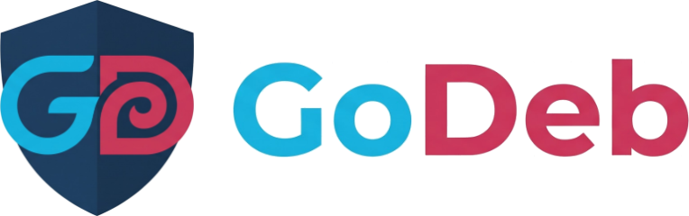

<p align="center"></p>

# GoDeb Play

**Spielserver-Panel für den Heimserver, das sich per WireGuard an einen GoDeb-Hub hängt.**

GoDeb Play läuft in einem Container oder einer VM zu Hause (z. B. LXC unter Proxmox) und kennt nur Spielserver. Es tritt einem [GoDeb](https://github.com/ZeroDos1988/GoDeb)-Hub als Standort bei; Spieler erreichen die Server dann über die öffentliche IP des VPS, ohne Portfreigabe am Heimrouter, auch hinter CGNAT oder DS-Lite.

```text
Spieler --> VPS (GoDeb-Hub, öffentliche IP) --DNAT/SNAT--> WireGuard --> GoDeb Play 10.8.0.3
                                                                          + Spielserver
```

> **Stand (10.11.2026):** Vorabversion, noch nicht auf echter Hardware getestet. Einrichtung, Login mit 2FA, Agent, Beitritt zum Hub, die Spiele Enshrouded (unter GE-Proton), Valheim und Satisfactory, die Verwaltung der GE-Proton-Versionen und Savegame-Backups sind umgesetzt. Siehe [ROADMAP.md](ROADMAP.md).

## Spielserver

- **Ein Klick zum Server:** SteamCMD, Serverdateien, GE-Proton (oder Wine) für Windows-Server, Vorgabe-Konfiguration mit Formular, systemd-Unit, Firewall. Enshrouded, Valheim und Satisfactory sind dabei; weitere brauchen nur eine Beschreibung im Code.
- **Jedes Spiel eigenes Konto und Sandbox**, nie root. Der root-Agent greift auf Spielverzeichnisse nur über `os.Root` zu, damit ein übernommener Spielserver ihn nicht per Symlink nach draußen lenken kann.
- **GE-Proton verwalten:** neue Versionen anzeigen, geprüft laden (SHA-512 des Releases), pro Spiel umstellen, ungenutzte löschen.
- **Savegames gesichert** vor jedem Update, auf Knopfdruck und vor jeder Wiederherstellung; Wiederherstellen mit einem Klick.
- **Spielerzahlen** per Steam-Query, sichtbar hier und auf dem GoDeb-Hub.
- **Ports nur im Tunnel:** Öffentlich werden sie über die Portweiterleitung des Hubs in GoDeb; die Seite nennt genau, was dort einzutragen ist.

## Was es mit GoDeb teilt

Der Unterbau ist aus GoDeb kopiert (Stand GoDeb `24f6000`, 07.11.2026) und soll nach GoDeb 1.0 in ein gemeinsames Go-Modul wandern:

- **Weboberfläche ohne root**, Systemänderungen nur im root-Agenten über einen Unix-Socket; der Agent prüft jeden 2FA-Code selbst.
- **Ersteinrichtung im Browser** mit Einmal-Token, erster Administrator, TOTP-2FA mit Backup-Codes.
- **Nur über Tunnel, Heimnetz (HTTPS) oder lokal** erreichbar, nie Klartext-HTTP auf LAN oder WAN.
- **Beitritt per Beitrittscode** (`godeb-join:…`) mit derselben strengen Prüfung der Client-Datei wie in GoDeb.
- Plugins für Dienste (inkl. Server-Neustart), Firewall (ufw), Updates (APT), Protokoll, Überwachung und WireGuard (nur der Tunnel zum Hub).

GoDeb Play hat eigene Namen, damit es nie mit GoDeb kollidiert: Programm `godeb-play`, Dienste `godeb-play.service` und `godeb-play-agent.service`, Benutzer `godeb-play`, Daten in `/etc/godeb-play` und `/var/lib/godeb-play`.

## Installation (zum Testen)

Aus dem APT-Repo (Debian 13, amd64 und arm64; verfügbar ab dem ersten Release; Updates dann über das Plugin „Updates“ oder `apt upgrade`):

```sh
sudo wget -O /usr/share/keyrings/godeb-play-archive-keyring.asc https://zerodos1988.github.io/godeb-play/godeb-play-archive-keyring.asc
sudo wget -O /etc/apt/sources.list.d/godeb-play.sources https://zerodos1988.github.io/godeb-play/godeb-play.sources
sudo apt update
sudo apt install --no-install-recommends godeb-play
```

Bis 1.0 gibt es nur Vorabversionen; die Suite `trixie` enthält sie, solange es kein stabiles Release gibt. Selbst bauen geht auch (Befehle für einen Proxmox-Container in [DOCUMENTATION.md](DOCUMENTATION.md#container-unter-proxmox-vorschlag-noch-nicht-auf-echter-hardware-geprüft)):

```sh
scripts/build-deb.sh
sudo apt install --no-install-recommends ./godeb-play_*_amd64.deb
```

Auf dem GoDeb-Hub einen Standort anlegen (`sudo godeb site add spiele` oder WireGuard → „+ GoDeb-Server zu Hause“), dann den Link aus der Installation öffnen (`sudo godeb-play setup-url`) und im Assistenten den Beitrittscode einfügen. Ohne Browser: `sudo godeb-play setup --join -`.

## Entwicklung

Befehle und Regeln stehen in [CLAUDE.md](CLAUDE.md), Architektur und API in [DOCUMENTATION.md](DOCUMENTATION.md).

## Lizenz

GPL-3.0, siehe [LICENSE](LICENSE).
